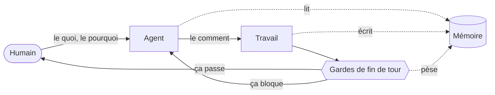
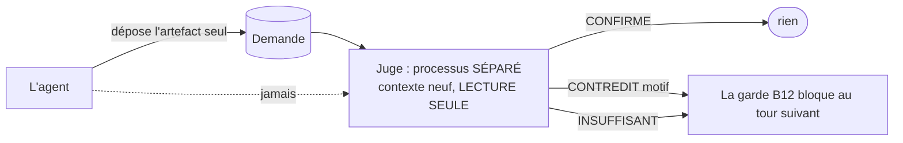
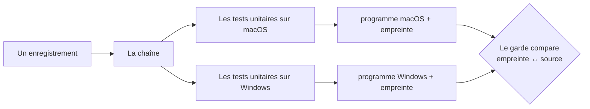

# Le harnais — comment ça marche

> Pour quelqu'un qui n'a jamais vu ni « boucle agentique » ni « harnais ».
> Les comportements Copilot cités ici viennent de la documentation officielle,
> du CLI 1.0.90-0 et 1.0.91-1, et de mesures faites dans l'app GitHub Copilot
> (journaux de session) ; l'activation effective reste à mesurer sur chaque projet.
> Pour travailler à plusieurs agents dans l'app, voir la section 9.

---

## 1. Le problème, avant la solution

Un agent de code, c'est un modèle de langage à qui on donne un dossier, des
outils (lire, écrire, exécuter) et un but. Il travaille seul, parfois des
heures.

Trois choses tournent mal, toujours les mêmes :

| | ce qui se passe |
|---|---|
| **Il oublie** | chaque session repart de zéro. Ce qu'il a appris hier n'existe plus. |
| **Il affirme** | il annonce « c'est fait, tout marche » sans avoir vérifié — et personne ne le reprend. |
| **Il garde ses questions** | il bute sur une décision qui appartient à l'humain, et l'enterre dans un paragraphe que personne ne lit. |

La réponse habituelle est de **le lui demander** : « pense à vérifier », « pense
à noter ». Ça ne tient pas. Une consigne dans un prompt ne constitue pas une garde exécutable.

**Le harnais est la réponse inverse : ne rien demander au modèle, et brancher
des déclencheurs que la machine exécute, qu'il le veuille ou non.**

---

## 2. L'idée en une image



Trois boucles imbriquées :

1. **La boucle courte** — l'agent travaille, les gardes l'arrêtent s'il s'apprête
   à rendre la main dans un mauvais état. Il repart, corrige, revient.
2. **La boucle de mémoire** — ce qu'il lit est noté ; ce qu'il apprend est écrit ;
   ce qui n'a jamais servi s'endort.
3. **La boucle humaine** — ce qui demande une décision remonte, en question
   fermée, sur le téléphone du commanditaire.

---

## 3. Ce qu'on installe

Le paquet, pour GitHub Copilot CLI seulement, fournit `hooks/copilot.json`, `skills/`,
le programme `py/` (Python 3.9+, bibliothèque standard) et ses lanceurs `bin/harnais`
(sh) et `bin/harnais.cmd` (Windows). Les hooks PowerShell cherchent Python eux-mêmes
(`py -3`, puis `python`, jamais le relais du Microsoft Store) ; `hooks/copilot.json`
est écrit par `outils/genere_hooks.py`, jamais à la main.

```powershell
copilot plugin marketplace add "C:\Outils\copilot-harness"
copilot plugin install harnais@atelier-copilot
harnais adopte         # à blanc
harnais adopte --go    # pose la mémoire et déclare le plugin
```

L'installation guidée (prompt à coller, prévisualisation, accord explicite) est
dans le [README](README.md). La marketplace locale charge le code **en direct** : `/restart` ou une nouvelle
session prend la correction sans `copilot plugin update`. Le paquet est déclaré
par `enabledPlugins` et résolu par `extraKnownMarketplaces` (marketplace connue)
ou `~/.copilot/installed-plugins/`. `~/.copilot/plugin-data/atelier-copilot/harnais`
garde l'état hors du code. Le harnais lit `COPILOT_PLUGIN_ROOT`,
`COPILOT_PLUGIN_DATA` et `COPILOT_PROJECT_DIR` (noms lus dans le CLI 1.0.90-0,
qui pose aussi `PLUGIN_ROOT` et `PLUGIN_DATA`) ; à défaut, le lanceur retrouve
le paquet et l'état par leurs chemins sous `~/.copilot/`.

**Limite de la forme multi-agents :** `.github/copilot/settings.json` est lu à
la racine du dépôt git, **pas depuis le dossier courant**. Les déclarations
`agents/<nom>/.github/copilot/settings.json` d'un dépôt commun ne chargent
pas chacune le plugin ; les hooks qu'il porte n'y partent donc pas grâce à
ces fichiers. Un plugin activé à la racine est actif pour le dépôt entier,
non agent par agent. Vérifier dans chaque session le briefing et le refus de la
garde ; ne pas remplacer la mesure par le contenu de la déclaration.

Copilot lit aussi les fichiers d'un autre assistant : `CLAUDE.md`,
`.claude/CLAUDE.md`, `.claude/skills/` et `.claude/settings(.local).json`
(relevé dans le CLI 1.0.90-0). Le harnais n'y écrit jamais ; si un ancien
paquet `harnais@atelier` est déclaré dans `.claude/settings.json`, il signale
le risque de double chargement.

---

## 4. Les déclencheurs Copilot

| Événement | Harnais | Sortie décisive |
|---|---|---|
| `sessionStart` / `SessionStart` | briefing d'entrée | `additionalContext` |
| `userPromptTransformed` | le briefing est injecté à **chaque message**, dans un bloc `<harnais>` du message remis au modèle | `modifiedTransformedPrompt` |
| `preToolUse` / `PreToolUse` | garde de commit et périmètre d'écriture `Edit|Write` | `permissionDecision: "deny"` + raison |
| `postToolUse` / `PostToolUse` | journal des commits réussis ; `lecture` (sur `Read` et `Bash`) crédite les sections de faits lues | résultat / contexte |
| `agentStop` / `Stop` | cinq gardes de fin de tour | `{"decision":"block","reason":"…"}` |

Les noms PascalCase reçoivent des champs d'entrée `snake_case` ; les noms camelCase utilisent des champs `camelCase`.
`userPromptSubmitted` ne permet pas à un hook de commande de modifier le
message : seul `userPromptTransformed` accepte la transformation effective.
Un `PreToolUse` à matcher `Edit|Write` voit `edit`/`create`, pas les écritures
passant par un shell. C'est une limite de la garde, pas une isolation globale.
Le hook `preToolUse` commande refuse une erreur de commande, mais **son timeout
laisse passer** : ne pas promettre le fail-closed dans ce cas.

`agentStop` peut demander de continuer, mais Copilot **termine après huit
blocages consécutifs**, même si le hook persiste. La signature de l'état évite
de répéter un blocage identique ; une garde ne garantit pas un blocage sans
limite. Aucun hook d'usage de mémoire auto fichier n'est conservé.

Une déclaration ne prouve pas l'exécution. Vérifier le briefing, le refus de
la garde et la trace de version avant d'annoncer qu'un agent est servi.

Le briefing identique est dédupliqué entre `SessionStart` et
`userPromptTransformed` par **identifiant de session et dossier de l'agent**.
Les faits, l'état, les tâches, les périmètres et le carnet sont comparés par
leur contenu : un changement réinjecte le contexte au prompt suivant. Un
changement d'agent dans le menu et une compaction de la conversation le
réinjectent aussi (section 8).
Sans identifiant fourni par l'hôte, aucune session n'est assimilée à une autre :
la déduplication n'est alors pas garantie.

---

## 4 bis. Les gardes d'avant l'outil, portées de Claude (0.17 à 0.19.3)

Quatre gardes que le harnais Claude a reçues, jouées ici dans les deux shells
(bash et PowerShell). Chacune refuse par `permissionDecision: "deny"` à la racine
de la sortie, en ASCII ; chacune laisse passer une entrée illisible.

**La Production (`production`, PreToolUse sur `Bash`).** Rien ne part sur une
branche de production sans laissez-passer : `git push` sous toutes ses formes
(`origin main`, `HEAD:main`, `refs/heads/main`, `+main`, un motif, `--all`,
`--mirror`, un `git push` nu depuis cette branche), `gh pr merge`, l'API GitHub en
écriture (`gh api`, `curl`, `Invoke-RestMethod` / `Invoke-WebRequest` avec
`-Method Post|Put|Patch|Delete`). Rien n'est fermé sans réglage : l'en-tête de
`brain/fact/rules.md` donne `production:` (les branches), `production-agent:` (le
seul qui peut demander un laissez-passer) et `production-duree:` (minutes). Le
laissez-passer se pose par `harnais laissez-passer "<le oui de l'humain>"`. L'agent
se lit comme partout ici (menu de l'app, dossier, QA par défaut) ; le shell d'un
agent lancé à la racine d'une copie ne le sait pas, et lit alors `--session <id>`
ou `--journal <events.jsonl>`. Sans identité, l'appelant n'est pas l'agent nommé :
fermé. Non couvert : une branche passée par variable (`git push origin $b`), un
alias git, un script qui pousse à la place de l'agent.

**Le coffre (`coffre` avant, `coffre-temoin` après).** Aucun outil n'affiche une
valeur de secret. Avant (PreToolUse sur `Bash`, `Read`, `Grep`) : Doppler
(`secrets`, `secrets get`, `download --no-file`, les écritures qui réimpriment le
coffre, `doppler run -- env`), la lecture brute d'un `.env*`, d'un `.mcp.json` ou
d'un dossier caché `.…secrets`, `supabase status`, `gh auth token`,
`security find-*-password -w`, `stripe config --list`. La même commande passe si
sa sortie est jetée, écrite dans un fichier, capturée dans une variable, ou
réduite aux noms. Sous PowerShell : `Get-Content` / `gc` / `type` / `Select-String`
d'un fichier de secrets, `Write-Host $env:CLE`, `$env:CLE` seul, `Get-ChildItem
Env:`, `[Environment]::GetEnvironmentVariable(...)` — un nom de variable ne se juge
que s'il se lit comme un secret (KEY, TOKEN, SECRET, PASSWORD…) ; `(Get-Content
.env).Count`, `| Measure-Object`, `| Out-Null`, `$x = …` passent. Après
(`coffre-temoin`, PostToolUse) : une clé de forme connue passée en clair
(Supabase, Stripe, GitHub, Doppler, Anthropic, JWT hors clé `anon`) est signalée,
avec sa sorte et une empreinte, jamais la valeur. Le témoin ne coûte pas un
processus de plus : il passe par `apres-bash` (avec le journal et la lecture des
faits) et par `apres-lecture` (`Read` et `Grep`). Non mesuré : que Copilot remette
`additionalContext` au modèle après un outil ; le journal des fuites, lui, s'écrit
toujours. Non couvert : un chemin PowerShell construit, une valeur relue depuis une
variable, `[IO.File]::ReadAllText`.

**Les sous-agents (`sous-agent`, PreToolUse sur `task`).** Le 18/10/2026, un
sous-agent a lu 2 273 images dans une seule conversation. La
garde refuse le lancement d'un sous-agent dont la consigne lui fait regarder du
visuel (un verbe qui voit suivi d'une image, d'une capture, d'une diapositive, d'un
PDF ou d'un fichier de ces formats), rédiger des textes alternatifs, passer par
l'OCR, ou lui confie plus de 30 médias. Un audit qui *parle* d'images sans les
regarder passe, et un lot de texte aussi, quelle que soit sa taille. Sur le oui de
l'humain, `harnais laissez-passer-lot "<son oui, cité>"` laisse partir le visuel
120 minutes (jamais plus de 30 médias à la fois : un sous-agent neuf par lot) ;
chaque lancement est journalisé. Adaptations : le laissez-passer vaut pour la copie
de travail (la racine git), pas pour un agent, car le shell d'un agent de l'app ne
sait pas qui parle ; les champs de `task` ne sont pas documentés dans ce dépôt, donc
tous les champs texte des arguments sont lus (`description` et `prompt` d'abord) ;
pas mesuré contre un `task` réel, ni le nom du filtre que l'hôte compare (`Task`
ou `task` : les deux sont déclarés).

**Les consignes (`consignes`, PreToolUse sur `Edit`, `Write`, `Bash`).** Décision du
14/10/2026 : seuls le CTO (et, chez Claude, Harness) écrivent le fichier de
consignes. Chez Copilot ce sont `AGENTS.md`, `CLAUDE.md` (que Copilot lit aussi) et
`.github/copilot-instructions.md` (la copie de la méthode que `adopte` pose). Le
seul gardien est le CTO ; son nom se compare sans la casse (`atelier-monte` crée le
dossier `cto`). L'agent est celui que le harnais résout (menu de l'app, dossier de
lancement, QA par défaut) ; sans agents dans le projet, c'est le dossier de travail,
ou — à la racine d'une copie — le dépôt principal. Les autres lisent librement.
Le jugement porte sur la CIBLE de l'écriture, jamais sur le texte de la commande :
une ligne de todo qui cite `AGENTS.md` passe. Sous PowerShell : `Set-Content`,
`Add-Content`, `Out-File`, `Remove-Item`, `Rename-Item`, `Move-Item`, `Copy-Item`
(et leurs alias), `>` / `>>`, `[IO.File]::WriteAllText(...)`. Non couvert : un
chemin construit dans une variable, un script `.ps1`, et les fichiers
d'instructions par chemin (`.github/instructions/*.instructions.md`), que ce dépôt
ne documente pas ; les profils `.github/agents/*.agent.md` sont déjà fermés aux
agents par leur périmètre.

**La fusion (`fusion`, 2.2.0, jouée dans le même processus que `production`).**
Quand la mémoire voyage avec le code, deux personnes qui pilotent chacune un agent
du même projet écrivent dans les mêmes fichiers. Deux règles, dans un dépôt qui a
un distant et qui porte une mémoire :

- **récupérer d'abord** : `git push`, `git merge <branche>` et `git rebase <base>`
  sont refusés si le dernier `git fetch` date de plus de 15 minutes, ou si la
  branche suivie a des commits que la copie n'a pas intégrés (le refus nomme les
  fichiers de mémoire concernés). `git pull` récupère de lui-même et passe ;
- **rien perdu en résolvant** : pendant une fusion, un rebase ou un cherry-pick
  arrêté sur conflit, `git commit` et `--continue` sont refusés si la résolution
  indexée d'un fichier de `brain/fact/` ou `brain/mind/` (à toute profondeur) perd
  une ligne écrite par l'un des deux côtés et retirée par aucun, ou garde un
  marqueur de conflit. Chaque côté est lu contre la base commune : une tâche
  cochée remplace l'ancienne sans l'exiger ; `maj:`, `sante:` et `jalon:`
  n'existent qu'une fois et ne comptent pas.

` # fusion-ok` lève les deux règles (hors réseau, ou une ligne abandonnée exprès).
Le briefing ajoute une ligne `partage:` quand la branche suivie a avancé sans la
copie, lue sur les références locales, sans réseau. Après un pull ou une fusion
qui apporte des commits d'un AUTRE auteur (adresse git différente de celle de la
copie) dans `brain/fact/`, `brain/mind/` ou `.logs/` du projet, le briefing
suivant ajoute une ligne `arrivé :` — les auteurs, le nombre de commits, les
fichiers — et demande de relire et d'intégrer avant d'agir. Un curseur par agent,
dans le dossier d'état, retient la dernière tête lue : la ligne part une fois, et
le premier passage n'annonce pas l'historique. Les journaux `.logs/` d'un
projet logé se fusionnent sans conflit (`merge=union`, posé par `adopte --projet`).
Non couverts : un client graphique, un alias, une fusion sans conflit (Git ne
perd rien ligne à ligne).

## 5. Les cinq gardes de fin de tour

C'est le cœur. Au moment où l'agent s'apprête à rendre la main, cinq questions
sont posées à l'état du projet. Chacune peut le renvoyer travailler.

| | Ce qu'elle refuse |
|---|---|
| **B1** | du code a bougé et le fichier de tâches n'a pas suivi |
| **B5** | un chantier partagé fini sans une ligne au carnet d'équipe |
| **B6** | un fichier de faits touché sans l'autorisation explicite du commanditaire |
| **B13** | une question **nouvelle** pour l'humain est rangée dans la liste sans être posée dans le message de fin de tour |
| **B14** | sur un projet réglé sur Notion (`HARNAIS_CANAL=notion`) : une question pour l'humain sans le lien de sa ligne dans la base Décisions — et plus rien ne part vers les Rappels |

Depuis 1.3.0, les autres gardes des versions précédentes ne s'exécutent plus : sous
Copilot elles renvoyaient l'agent par de faux messages de l'utilisateur sans rien
apporter au suivi. Il s'agit de B2, B3 et B4 (réponses et demandes venues des
Rappels, demande `!cible`), B7 et B9 (constats rejouables et constats tombés), B8
(forme des questions), B10 (liste des rechutes), B11 (acharnement sur la cible) et
B12 (relecteur indépendant). Leur code reste dans `attente.rs`, derrière la liste
`GARDES_ACTIVES` : en rajouter une dans cette liste suffit à la réarmer.

### Ce que l'humain voit quand une garde bloque

Quand une garde renvoie l'agent au travail, l'app affiche sa raison dans la
conversation **comme un message de l'utilisateur**, alors qu'il ne l'a pas
écrit. Depuis 0.18.1, ce message commence par une signature (« rappel automatique
du harnais, pas écrit par @user »), nomme la garde (`B13-poser`, par exemple) et dit
en une phrase ce qu'elle a vu. Les exemples qu'il contient sont annoncés comme
inventés. L'humain n'a rien à faire : l'agent corrige seul. Un test vérifie que
chaque garde du code a sa phrase en clair.

### La garde B7, pour comprendre l'esprit

Une **tâche** (« construire X ») reste vraie jusqu'à ce qu'on la fasse. Un
**constat** (« X manque ») peut cesser d'être vrai **tout seul**, sans que
personne y touche. Et un constat bien mesuré n'est pas plus durable qu'un
constat bâclé : seulement plus crédible, donc **plus dangereux quand il périme**.

La garde exige donc, sous chaque constat, de quoi le rejouer :

```
- [ ] !haut @user ?constat  **J'ouvre une page de contact ? oui / non**
      oui → tes clients peuvent t'écrire ; 1 h de travail, en ligne demain.
      non → ils n'ont que le téléphone ; on ferme le sujet.
      ↻ service :: curl -s -o /dev/null -w '%{http_code}' https://x/contact :: ^404$
```

La dernière ligne est rejouée **au moment où la question part vers l'humain**,
et elle a trois issues : **TIENT** · **TOMBÉ** (la question disparaît de sa
liste) · **MUET** (la vérification n'a pas abouti). *Un contrôle qui échoue ne se
lit jamais comme un constat confirmé.*

---

## 6. La mémoire — trois maisons et un journal

| Dossier | Nature | Plafond |
|---|---|---|
| `brain/fact/` | faits communs du projet | 4 fichiers, 5 en équipe (`roles.md`) |
| `brain/mind/` | état d'un agent : `state.md`, `todo.md` | 2 fichiers par agent |
| `assets/<nom>/` | ce que chaque agent produit (forme compacte, 0.19) | aucun |
| `brain/workspace/` | carnet d'équipe, ignoré par Git (seul `.gitkeep` voyage) | aucun |
| `brain/poids.json` | confiance des sections de faits (voir plus bas) | — |
| `docs/` | l'archive du projet : décisions, audits, passations, ressources | aucun |
| `.logs/` | journal de commits append-only | aucun |

`cap:` est dans `brain/fact/base.md`. L'en-tête de `state.md` exige `maj`,
`sante`, `jalon` ; les tâches de `todo.md` sont lues **dans tout le fichier**
avec `[ ]`, `[>]`, `[~]`, `[x]`, `!haut`/`!moyen`/`!bas` et `@<qui>`.
Ne jamais compresser `todo.md` ou `.logs/` : le programme relit les marqueurs.
L'ancien rangement `.fact/`/`.mind/` reste lisible ; `brain-migre` le déplace
sur décision. Un projet qui porte les deux formes ne reçoit aucune mémoire.

Sous Copilot, chaque session résout la mémoire de **son propre checkout** : la
copie de travail quand l'app en crée une (« New worktree »), le dossier principal
quand elle travaille « dans le checkout existant » (« Current checkout »). La
mémoire d'une copie ne se replie jamais sur celle du dépôt principal. Un worktree sans `brain/` reste sans mémoire,
même si le principal en possède une. Le carnet est également local au worktree ;
partager des changements se fait par Git, pas par une écriture invisible dans
le checkout d'un autre agent.

Par défaut, l'app Copilot ouvre chaque session dans une telle copie, rangée sous
`~/.copilot/repos/copilot-worktrees/` (le choix « Where to work » de la section 9
permet de travailler dans le dossier principal) : les dossiers voisins de l'agent ne
sont alors pas l'atelier. Le briefing le dit (ligne `lieu`), avec la branche et
le dépôt principal, et `atelier-monte` écrit dans le rôle du CTO le chemin
absolu de l'atelier et celui du paquet, pour qu'aucun chemin ne soit déduit du
dossier courant. Quand le terminal de la session ne trouve pas `harnais`, le
briefing donne son chemin complet (ligne `commande`) ; l'installateur ajoute
`bin/` au PATH de l'utilisateur pour que ce cas reste l'exception.

Copilot n'a pas de mémoire de notes locale indexée par chemin. Les constats durables
vont dans `brain/` ou `docs/`, les leçons transversales dans la méthode après
validation. `~/.copilot/session-state/` conserve les sessions, pas une quatrième
maison de notes. Son comportement après renommage de dossier : **non mesuré**.

**Copilot Memory est coupé.** Copilot retient de lui-même des faits de dépôt et
des préférences, chez GitHub, que rien ne confronte à `brain/fact/`. Relevé dans
le CLI 1.0.90-0 : le réglage est `memory` dans
`~/.copilot/settings.json`, **actif quand il est absent**, écrit par
`/memory on|off`. L'installateur pose `"memory": false` (sauf
`-KeepCopilotMemory`), note la valeur d'avant au journal et la rend à la
désinstallation si personne n'y a touché entre-temps ; une mise à jour respecte
une mémoire rallumée par l'utilisateur. Le briefing relit le réglage à chaque
session et signale une mémoire active, absente ou illisible. Que ce réglage soit
aussi accepté dans `.github/copilot/settings.json` d'un dépôt : **non mesuré**.

Les sections de faits indiquent comment elles ont été établies, sur la ligne
sous leur titre : `> **mesuré** · 01/10/2026 — la façon de rejouer la mesure`.
Le niveau (`mesuré`, `observé`, `supposé`, `dit`) fixe d'où part la confiance ;
une nature facultative après la date (`· croyance`, `· expérience`, `· fait`)
fixe la vitesse de vieillissement : 4 semaines pour un fait, 2 pour une croyance
— une supposition l'est d'office —, 6 pour une expérience. Le briefing applique
cette péremption. Sans lien rejouable, un niveau n'est qu'un mot.

**La confiance des sections, `brain/poids.json`.** Le hook `lecture`
(PostToolUse sur `Read` et `Bash`) note quelles sections de `brain/fact/`
l'agent lit. Relevé sur Copilot CLI 1.0.90-0 : une lecture par l'outil `view`
arrive sous `tool_name: "Read"` avec `tool_input.path`, et une lecture partielle
porte `view_range: [début, fin]` — elle ne crédite que les sections qu'elle
couvre ; une lecture par le shell arrive sous `Bash`, la commande en clair.

| Fichier | Contenu | Durée de vie |
|---|---|---|
| `brain/poids.json` (commité ; ignoré dans un projet logé) | par section : `conf`, `jours_lus`, `vu`, `verdicts` | suit le projet, ses worktrees et ses agents ; dans un projet logé, reste sur le poste |
| registre de session (dossier d'état) | les sections lues depuis le dernier verdict | vidé à chaque résultat |

La confiance part du niveau (mesuré 80, dit 85, observé 60, supposé 40, inconnu
50). Un résultat la multiplie, pour les seules sections lues depuis le verdict
précédent : constat qui tient ×1,03, garde qui mord ×0,92, constat démenti deux
fois ×0,90. `vu` et `jours_lus` ne bougent qu'une fois par jour, pour ne pas
réécrire le fichier à chaque lecture. Le briefing signale les sections sous 50
et celles qui dorment (30 jours sans lecture, gradués par la nature) ;
`harnais curateur` en donne le détail. Rien n'est jamais déplacé ni effacé.

---

## 7. Le relecteur — celui qui n'a pas écrit ce qu'il relit

Le problème est ancien : **celui qui écrit ne peut pas être celui qui juge.**
Un même contexte qui se relit lui-même n'est pas une relecture, c'est un biais de
confirmation avec une commande.

En équipe, on sépare les rôles par **agent**. Seul, on les sépare par
**contexte** :



Ce que le juge reçoit : **l'affirmation, ce qui l'accompagne, et de quoi la
vérifier.** Jamais le raisonnement qui y a mené, jamais la conversation.
**Il ne peut pas confirmer ce qu'il n'a pas vu** — c'est l'équivalent d'une
permission refusée, obtenu autrement.

Quatre règles qui ne sont pas décoratives :

1. **Le juge est indépendant** — un processus séparé, en lecture seule : ni
   écriture, ni suppression, ni enregistrement. Un juge qui pourrait réparer ce
   qu'il reproche n'est plus un juge.
2. **Son verdict est un jeu fermé** — `CONFIRME` · `CONTREDIT <motif>` ·
   `INSUFFISANT <ce qui manque>`. Jamais de prose.
3. **L'agent ne peut pas modifier ses critères** — ils vivent dans un fichier
   livré avec le paquet ; les changer laisse une trace dans l'historique.
4. **Un juge muet, coupé ou bavard n'est JAMAIS un accord.** Tout ce qui n'entre
   pas dans le jeu fermé devient « insuffisant ».

Et une porte laissée ouverte : le juge n'a pas raison d'office. Le message de
blocage propose trois issues — *il a raison* · *la mesure est fausse* · *il a
tort et je peux le montrer* — et n'interdit que la quatrième : **passer outre
sans rien écrire.**

---

## 8. Trois formes de projet : un agent, ou une équipe

Un projet est tenu par **un** agent par défaut. Plusieurs agents n'ont de sens
que pour des lots aux rythmes et aux contextes disjoints (voir `roles.md`), jamais
« parce que le projet est gros ». Trois rangements existent :

| | Mono | Équipe « dossier » (historique) | Équipe compacte (0.17+, sur choix explicite) |
|---|---|---|---|
| Rôle | `AGENTS.md` du projet | `agents/<nom>/AGENTS.md` | `.github/agents/<slug>.agent.md` : profil Copilot **et** rôle |
| Périmètre d'écriture | — | `agents/<nom>/.github/copilot/perimetre.json` | `.github/copilot/perimetres/<slug>.json` |
| Ce que l'agent produit | — | `agents/<nom>/livrables/` | `assets/<nom>/` (depuis 0.19) |
| État | `brain/mind/` | `brain/mind/<nom>/` | `brain/mind/<nom>/` |
| L'agent se choisit | — | par le dossier de lancement ou le menu | **par le menu d'agent de l'app** (ou `copilot --agent`) |

La forme compacte se crée avec `harnais adopte --equipe OPS,PO,QA --compact` (projet
neuf) ou `harnais equipe --agents A,B --compact` (un mono qu'on passe en équipe) ;
`harnais equipe --compact` exporte une équipe « dossier » existante : à blanc par
défaut, sans rien déplacer ni supprimer. L'ancienne forme reste prise en charge.

```text
projet/
  AGENTS.md                                  méthode et rôle commun du projet
  .github/agents/<slug>.agent.md             profil Copilot ET rôle de chaque agent
  .github/copilot/perimetres/<slug>.json     garde d'écriture de chaque agent
  .github/copilot/settings.json              active le paquet, une fois pour tous
  brain/fact/                                faits communs (4 fichiers, + roles.md)
  brain/mind/<nom>/state.md et todo.md       état de chaque agent
  assets/<nom>/                     ce que chaque agent produit
  brain/workspace/                           carnet d'équipe (ignoré par Git)
  brain/poids.json                           confiance des faits
  docs/                                      l'archive : décisions, audits, passations
```

**Les périmètres.** Un périmètre sépare les agents **entre eux** : il dit quel est
le territoire des pairs, il ne borne pas ce qu'un agent sait faire. Un fichier
`perimetres/<slug>.json` porte une liste `deny` (relative à la racine du projet) et,
facultativement, une liste `allow` ; `deny` prime. Un périmètre absent, illisible ou
à `allow` mal formé refuse toute écriture.

- **OPS et PO** n'ont, par défaut, qu'une liste `deny` : la mémoire et l'établi des
  pairs, les faits communs (un seul écrivain), `brain/poids.json` et les fichiers qui
  font tenir le harnais (`.github/agents`, `.github/copilot`). Tout le reste leur est
  permis : la CI, la configuration MCP, le code du projet, les documents.
- **QA**, qui éprouve sans réparer, a une liste `allow` : sa mémoire, son établi et
  les cinq fichiers de faits (`base`, `stack`, `architecture`, `rules`, `roles`), ces
  derniers après validation explicite de l'humain. Il fait les plans que les autres
  exécutent. Un commit documentaire de QA est permis avec l'état à jour et
  ` # fact-ok` pour les faits ; jamais ` # mind-ok`.
- **Les outils** : aucun profil ne les limite (`tools: ["*"]` dans le journal de
  session). Tous les agents ont accès à tous les outils, MCP compris ; les serveurs
  MCP se déclarent pour le projet (section 9.7). QA les utilise en lecture seule :
  cela vient de son rôle et des comptes en lecture seule, pas de la garde, qui ne
  couvre ni le shell ni les outils MCP.

**L'établi.** `assets/<nom>/` reçoit les plans, analyses et scripts d'un
agent. Il est séparé de `docs/`, qui reste l'archive du projet. La garde de commit
ne le compte pas comme du code : un script SQL livré dans l'établi n'oblige pas à
mettre l'état à jour (le même fichier hors de l'établi, si). Un projet déjà compact
qui range ses productions ailleurs garde ses périmètres tels quels : changer de
dossier est une migration décidée par l'humain, jamais faite par le harnais.
Avant la 1.2, l'établi vivait dans `brain/workbench/<nom>/` : la garde de commit
continue de l'ignorer, mais `brain/` ne porte plus que la mémoire, et un projet
neuf, ou migré, range ses productions dans `assets/`.

**Qui parle.** L'app Copilot lance chaque conversation à la racine d'une copie
de travail ou du dossier principal : le dossier de lancement ne dit pas qui parle.
L'agent se choisit dans le menu d'agent du champ de saisie, qui liste les profils
`.github/agents/` **commités**. Aucun hook ne reçoit ce choix ; Copilot l'écrit
dans le journal de la session (`~/.copilot/session-state/<id>/events.jsonl`,
écrit en direct, mesuré dans l'app et le CLI 1.0.91-1) : `subagent.selected` avec
le nom de l'agent, `subagent.deselected` pour « Default agent », avant le premier
hook, un nouveau à chaque changement par le menu, un nouveau en tête de la session
qu'ouvre `/clear`, intact après `/compact`. Les sous-agents de l'outil task
n'y écrivent ni l'un ni l'autre ; leurs événements portent un `agentId` et sont
ignorés, et ils n'héritent pas du profil.

Chaque hook lit ce journal et applique la règle : l'agent choisi dans le menu
(ou `copilot --agent <nom>`), sinon le dossier de lancement s'il est dans
`agents/<nom>/`, sinon **QA** s'il existe — « Default agent » prend QA —, sinon
aucun agent. Le harnais se place alors dans le contexte de cet agent (sa
mémoire `brain/mind/<nom>/`, son périmètre) : état, todo, garde de commit,
périmètre, journal et fin de tour le suivent. Le briefing le dit
(`agent : OPS — choisi dans le menu…, ligne 2`) et, quand Copilot ne l'a pas
chargé, **montre** le rôle : un profil qui demande au modèle de lire
`AGENTS.md` laisse la lecture à sa bonne volonté — mesuré. `harnais agent
--session <id> --racine <dossier>` rejoue la résolution, en lecture seule.

La garde `PreToolUse` du plugin lit les périmètres. Elle les ancre sur le dossier
de la session : la copie de travail en « New worktree », le dossier principal en
« Current checkout » ; depuis une copie, elle interdit aussi le dossier principal.
Un chemin relatif passé à un outil se lit depuis le dossier de la session.
`harnais equipe --profils` met à niveau un projet déjà en équipe. Copilot ignore
`permissions.deny` hors réglages managés. Les réglages du plugin ne valent qu'à la
racine git : le paquet s'y active une fois pour tous les agents, et la séparation
vient du choix d'agent et de la garde, à vérifier par un essai effectif. Sans plugin
chargé, il n'y a aucune garde.

Copilot lit `AGENTS.md` et `CLAUDE.md` sans ordre de priorité général : signaler
un doublon et ne pas laisser des contenus divergents. Copilot ne remonte pas
au-dessus de la racine Git pour trouver la méthode. `adopte` ajoute une copie
dans `.github/copilot-instructions.md`, en conservant le contenu existant.
Ce branchement est indépendant de `COPILOT_CUSTOM_INSTRUCTIONS_DIRS` :
le CLI SDK 1.0.90-0 mesuré ne chargeait pas le répertoire supplémentaire.
La variable reste utile aux hôtes qui la prennent en charge, sans être une
preuve de chargement. Un bloc de méthode déjà présent est conservé ; sa
mise à jour doit être réconciliée explicitement avec les règles du projet.

### 8 bis. Amener un projet existant à la forme actuelle

Deux sous-commandes, `mise-a-niveau` (`py/niveau.py`) et `demenage` (`py/demenage.py`), portées
du harnais Claude. Les trois formes de la section 8 plus la forme « un dossier par agent »
(celle de `adopte --equipe`) donnent quatre points de départ, et chacun a un geste :

| Le projet est... | Le geste | Ce qui bouge |
|---|---|---|
| `.fact`/`.mind` ou `memoire/` | `mise-a-niveau` | la mémoire va à `brain/`, `git mv` (l'historique suit) |
| en `brain/`, mono ou équipe | `mise-a-niveau` | rien ; on complète (faits, état, carnet, paquet) |
| équipe « dossier d'avant » | `demenage` | le code, ses copies et la mémoire, vers un dossier par agent |
| équipe compacte | aucun, **nommée** | rien : c'est un choix de Copilot |
| équipe « un dossier par agent » | `mise-a-niveau` | rien ; on complète |

**Le contrat commun.** À blanc par défaut ; `--apply` écrit, et `--agents-arretes` est exigé
dès que quelque chose bouge. Rien ne se perd, et chaque affirmation a son témoin : les
fichiers déplacés ou copiés sont comparés par empreinte (SHA-256) à l'arrivée ; les copies
du code, par nombre, branche, état git (HEAD et modifications non enregistrées) et
inventaire (taille et date, fichiers ignorés compris, donc `.env*`). Un témoin rouge déclenche
le retour arrière, par les mêmes gestes en sens inverse. Un `.env*`, un `.mcp.json`, un
`operations.md` ou une clé de forme connue (le détecteur du coffre) ne monte jamais dans la
mémoire : le plan est BLOQUÉ et nomme le fichier, jamais la valeur.

**Ce que `mise-a-niveau` réécrit.** Les `deny` et `allow` des fichiers de droits
(`agents/<nom>/.github/copilot/perimetre.json`, `.github/copilot/perimetres/<slug>.json`),
par composants de chemin et non par sous-chaîne (`memoire` ne mord pas `memoire-old`) ; un
droit relatif reste relatif, un absolu absolu, chacun garde son séparateur (`C:\…` comme
`C:/…`), et la casse ne distingue rien sous Windows. Un dossier qui se sépare en deux
(`memoire/agents/OPS` donne `brain/mind/OPS` et `brain/agents/OPS`) dédouble le droit qui le
visait. `outputs/` et `brain/workbench/` passent à `assets/` si, et seulement si, il n'y a
pas déjà un `assets/` ; sinon `CONFLIT`, rien n'est fusionné.

**Ce que `demenage` produit** est ce que produit la naissance : mêmes dossiers, mêmes profils
`.github/agents/`, mêmes périmètres (`equipe.perimetre_agent(..., equipe_forme=True)` : un
agent sans périmètre reçoit celui de la naissance, un agent qui en avait un garde le sien,
traduit), même déclaration du paquet, même `.gitignore`. Chaque droit garde son sens :
`brain/mind/QA` devient `agents/QA`, `brain/fact` devient `fact`, `brain/workspace` devient
`shared`, et tout ce qui était du code (`package.json`) devient celui de l'agent
(`agents/<nom>/code/package.json`). Séquence du code : `mv P P.code-demenage`, la mémoire
prend la place de `P`, `P.code-demenage` devient `agents/<premier>/code`, `git worktree
repair`, `git worktree move` de chaque copie, une copie neuve (`git worktree add -b`) pour
qui n'en avait pas.

**Deux départs.** (A) `brain/` a son propre dépôt : il devient le projet, historique compris
(séquence de Claude). (B) `brain/` est dans le dépôt du code, ce qui est l'ordinaire de
Copilot (la mémoire se lit dans la copie courante, donc se commite avec le code) : rien ne
peut sortir de ce dépôt sans le réécrire, la mémoire est donc **copiée** vers un dépôt neuf et
l'ancienne reste intacte dans le code, avec tout son passé. Dans le cas B, un échec pendant la
copie défait aussi le déplacement du code.

**Ce qui n'est pas mesuré.** Le chemin Windows réel (`worktree move` sur un dossier tenu par
un processus, chemins longs, antivirus) n'est éprouvé que par simulation de `os.name` et
par des chaînes de chemins ; un gros projet réel n'a pas été déménagé.

---

### 8 ter. Plusieurs projets dans un même dépôt de code (2.2.0)

Un dépôt de code héberge parfois plusieurs projets, chacun dans son dossier. Une
mémoire à la racine les mêlerait ; un dépôt de mémoire à part ajouterait un dépôt
à synchroniser. La mémoire de chaque projet vit donc **à côté de son code**, et se
partage par push et pull, comme lui :

```text
.github/agents/<court>-<rôle>.agent.md          profil ET rôle, marqué du dossier du projet
.github/copilot/perimetres/<court>-<rôle>.json  périmètre de l'agent
<dossier>/brain/fact/                           faits du projet (+ roles.md)
<dossier>/brain/mind/<rôle>/state.md, todo.md   état de chaque agent
<dossier>/assets/<rôle>/                        livrables
<dossier>/docs/decisions.md                     le daté
<dossier>/.logs/                                journal des commits (fusionné par union)
<dossier>/brain/poids.json                      compteurs de lecture, hors de Git (un par poste)
```

L'app ne lit les profils, les réglages et la méthode qu'à la racine git : la
session s'ouvre à la racine, et **le profil choisi dans le menu désigne le
projet**. Il le dit dans son corps, par une marque que l'app transmet au modèle
sans l'interpréter (une clé inconnue dans l'en-tête risquerait de faire écarter
le profil) :

```text
<!-- harnais:projet dossier="services/flux-a" esprit="OPS" -->
```

Le harnais se place alors dans `<dossier>/brain/mind/<esprit>/` : briefing,
garde de commit, journal, fin de tour et vue d'équipe suivent ce projet. Le nom
de l'agent est celui du profil (`flux-a-ops`) : deux projets ont chacun leur OPS
sans se confondre. Lancé en CLI depuis un sous-dossier d'un projet, le harnais
trouve aussi sa mémoire en remontant jusqu'au premier `brain/`.

**Le périmètre** d'un agent de projet logé porte une liste `allow` : son dossier de
projet. Il n'écrit ni dans le code d'un autre projet ni à la racine, sauf entrée
ajoutée à cette liste ; `deny` garde la mémoire et les livrables de ses pairs, les
faits (un seul écrivain, QA sur accord humain) et les fichiers du harnais. Les
faits des autres projets du dépôt sont verrouillés par la garde de commit comme
les siens (` # fact-ok`).

```powershell
# À la racine du dépôt de code — à blanc, puis --go.
harnais adopte --projet services\flux-a --equipe OPS,PO,QA --nom flux-a
# Une mémoire brain\ déjà commitée à la racine descend dans le projet :
harnais adopte --projet services\flux-a --equipe OPS,PO,QA --nom flux-a --depuis-racine
```

`--depuis-racine` déplace `brain\` et les `assets\<rôle>\` nommés par `git mv`
(l'historique suit), renomme les profils et périmètres de racine en
`<court>-<rôle>`, ajoute leur marque et descend leurs chemins ; rien n'est
supprimé, et une mémoire déjà présente dans le projet arrête tout.

**Le paquet ne se déclare pas dans le dépôt partagé** : `.github\copilot\settings.json`
porterait le chemin du paquet sur un poste, faux sur celui d'à côté. `adopte
--projet` ne l'écrit pas et vérifie l'inscription utilisateur que pose
`install.ps1` ; il signale un fichier de réglages déjà présent.

## 9. Travailler à plusieurs agents dans l'app GitHub Copilot — la méthode

### 9.1 Le principe

Comme dans une entreprise : **un même espace de travail, des rôles et des
périmètres différents**. OPS, PO et QA améliorent chacun le même contenu ; aucun ne
dépend d'un autre agent pour toucher à son propre environnement. Ce qui les sépare :
leur **profil** (le rôle), leur **périmètre** (ce que la garde les laisse écrire) et
leur **mémoire** (`brain/mind/<nom>/`). Ce qui les réunit : les faits communs, le
même dossier, la même branche.

### 9.2 Ce que fait l'app si on ne lui dit rien

Elle ouvre chaque conversation dans une **copie de travail** (« New worktree ») :
un dossier à part sous `~/.copilot/repos/copilot-worktrees/…` et une branche neuve
(`workspace_type: worktree` dans les journaux de session). Trois conséquences :

- le travail d'un agent est invisible des autres tant qu'il n'est pas commité puis
  fusionné ;
- la garde est ancrée sur la copie : l'agent ne peut pas écrire dans le dépôt
  principal ;
- il faut donc un tiers (un autre agent, ou l'humain) pour intégrer le travail —
  l'inverse d'un espace commun.

Le profil `.github/agents/<nom>.agent.md` règle **qui** parle, pas **où** : il ne
change rien à la copie.

### 9.3 La méthode retenue

Deux réglages indépendants, et une branche :

1. **Une branche partagée `dev`**, créée à partir de `master` (ou `main`). Les trois
   agents y travaillent ; `master` reste la version stable, mise à jour par l'humain
   seul.
2. **Le dossier principal du projet reste sur `dev`.**
3. **Chaque conversation d'agent** se règle ainsi, sous le champ de saisie :
   « Where to work » = **Current checkout** (« Work in the existing checkout ») — et
   non « New worktree » ; menu d'agent = **ops**, **po** ou **qa**.
4. **Une conversation par agent.** Plusieurs peuvent tourner en même temps.

### 9.4 Pas à pas

**Mise en place, une fois.** Dans le dossier principal du projet :

```powershell
git status               # l'arbre doit être propre
git switch -c dev        # crée dev à partir de la branche courante (master) et passe dessus
```

Les profils `.github/agents/*.agent.md` doivent être **commités** avant d'ouvrir les
conversations : une nouvelle conversation part de l'état commité, un profil non
commité n'apparaît pas dans le menu d'agent.

**Ouvrir la conversation d'un agent** — à refaire pour chaque agent et chaque
nouvelle conversation :

1. nouvelle conversation sur le projet ;
2. « Where to work » : **Current checkout** ;
3. menu d'agent : l'agent voulu ;
4. envoyer le premier message.

**Vérifier que l'agent est bien servi.** Le briefing du harnais montre
`agent : OPS — choisi dans le menu d'agent du champ de saisie` et **ne montre pas**
de ligne `lieu : copie de travail`. `harnais agent --session <id> --racine <dossier>`
rejoue la résolution. Une écriture hors du périmètre de l'agent est refusée
(« Écriture refusée hors périmètre autorisé »).

**Mettre `master` à jour**, par l'humain, quand aucune conversation n'écrit :

```powershell
git fetch . dev:master   # avance master jusqu'à dev, sans quitter dev
```

La commande refuse si `master` a divergé (elle ne force jamais) ; mesurée sur un
dépôt de test.

### 9.5 Ce qui est mesuré, ce qui ne l'est pas

Mesuré le 02/10/2026 : trois conversations OPS, PO et QA ouvertes en « Current
checkout » travaillent dans le dossier principal, sur la même branche, chacune avec
son rôle (bloc `<agent_instructions>` présent) ; chacune écrit dans son établi ;
une écriture d'OPS dans l'établi de PO est refusée par la garde.

**Pas couvert, ou pas mesuré :**

- les écritures par le shell (PowerShell) ne passent pas par la garde ;
- les commits : chaque agent doit n'ajouter que ses propres chemins. Un commit
  fait avec le message par défaut « Save uncommitted changes » a pris tous les
  fichiers modifiés du dossier, ceux de plusieurs agents compris (observé). Deux
  commits simultanés peuvent se bloquer un instant (non mesuré) ;
- l'app retient-elle « Current checkout » d'une conversation à l'autre : non mesuré,
  à vérifier à chaque nouvelle conversation ;
- `/agent` tapé en cours de conversation : non mesuré (le menu, lui, est mesuré).

**Pièges :**

- ouvrir une conversation en « New worktree » par habitude : l'agent travaille alors
  dans une copie isolée, partant de `master` et non de `dev` (choisir `dev` comme
  « Base branch » si on s'y résout) ;
- changer la branche du dossier principal pendant que des conversations écrivent ;
- ouvrir une conversation avant d'avoir commité les profils ;
- « Default agent » : c'est QA qui tient la session (lecture et production
  documentaire), pas un agent « neutre ».

### 9.6 Dans une conversation

- `/compact` : l'agent est conservé (mesuré ; le choix reste dans le journal).
- `/clear` : ouvre une nouvelle session où l'agent est conservé (déduit : la commande
  elle-même ne laisse aucun événement).
- Changer d'agent par le menu : un `subagent.deselected` ou `subagent.selected`
  apparaît dans le journal ; le contexte de l'agent change au message suivant.
- Une nouvelle conversation démarre avec l'agent précédent (vu au démarrage de la
  session) : ne pas s'y fier sans lire le briefing.

### 9.7 Donner un accès à un agent (MCP)

Tous les agents ont accès à tous les outils : aucun profil ne limite `tools`. Un
serveur MCP se déclare **pour le projet** et chaque agent le voit ; un réglage par
agent n'est pas mesuré. Copilot lit `.mcp.json` ou `.github/mcp.json` à la racine du
dépôt (le support de `.vscode/mcp.json` a été retiré) et la configuration de
l'utilisateur ; `/mcp add`, ou « Add MCP server » dans l'app, en crée une. Un agent
dont le périmètre n'interdit pas ce fichier peut le modifier. Les identifiants ne
vont jamais dans un fichier commité : des comptes en lecture seule, déclarés hors du
dépôt. La garde de fichiers ne couvre pas les outils MCP : un agent en lecture seule
(QA) l'est par son rôle et par le compte utilisé, pas par la garde.

---

## 10. Comment on sait que ça marche

### Accueil du CTO et profils

Le parcours court est dans le README : créer `Agentic\CTO`, coller le prompt
d'installation, lire la prévisualisation et autoriser explicitement `-Go`,
puis redémarrer. La session d'installation ne crée pas les agents projet.

L'accueil est placé dans le **modèle de rôle CTO**, pas dans la méthode
commune : les agents projet ne doivent pas accueillir un premier projet.
Le **briefing** rappelle ce parcours quand le registre versionné
`docs/projects.json` du CTO existe et contient `{"schema":1,"projects":[]}`.
Il ne déduit pas une déclaration de la présence d'un dossier voisin.
Le mécanisme de déduplication évite deux injections identiques dans une
session ; une nouvelle session reçoit encore l'accueil tant que le registre
est vide. Après une adoption réussie, une entrée valide contient `name`,
`path` et une liste `profiles` parmi OPS/PO/QA : l'accueil s'arrête.

Pendant l'accueil, la garde de **forme** de fin de tour (B13 questions à
poser) se tait : les questions de cadrage (« nouveau ou existant ? »)
n'ont ni conséquences chiffrées ni critère « fini quand ». Les gardes d'état
restent armées.

Le projet agentique se crée sous la racine de l'atelier, avec son propre dépôt.
Un code qui existe ailleurs y reste : `harnais adopte --code "<chemin>"` en
inscrit l'adresse dans `brain/fact/architecture.md`, sans rien écrire dans le
dossier du code.
Un registre invalide produit une erreur explicite.

Le CTO termine sa mémoire, demande nouveau/existant et emplacement, présente
les trois profils, propose nom/périmètre/règles/ton, puis fait approuver les
écritures. Les fiches `skills/agentic-agents/references/profiles/` renvoient à
`roles.md` sans remplacer cette référence. Un seul profil reste mono-agent ;
plusieurs profils n'ont de sens qu'avec des responsabilités disjointes.
QA peut écrire sa mémoire, ses livrables et les cinq faits validés par
l'humain, sans réparation technique, sans prétendre que la garde Edit/Write bloque
les écritures shell.

Le registre et les instructions doivent être commités pour les nouvelles
sessions en worktree. Les ateliers existants conservent leur `AGENTS.md` :
la mise à jour du paquet n'actualise pas automatiquement un rôle personnalisé.
Il faut y intégrer ce nouveau parcours après accord.

C'est la partie qu'on oublie le plus souvent, et c'est celle qui décide.

### Le contrôle différentiel avec témoin

Quand un composant est réécrit, on fait tourner l'ancienne et la nouvelle
implémentation sur les **mêmes** entrées et on compare : code de sortie, message
**caractère par caractère**, appels extérieurs, et chaque fichier d'état
**octet par octet**.

> **Chaque contrôle porte son témoin.** Deux programmes qui ne font rien
> comparent égal. Un banc sans contrôle négatif ne se distingue pas d'un banc
> qui regarde ailleurs.

### On compte les chemins TRAVERSÉS, pas les cas joués

Une comparaison peut rendre « aucun écart » sur de nombreux cas sans avoir atteint
toutes les sorties bloquantes : celles qui vivent derrière une barrière
qu'aucun cas ne franchit restent non vérifiées. Le silence se lit comme une
confirmation.

**Une suite de contrôles doit énumérer les chemins qu'elle traverse, et se
déclarer ratée si l'un manque.**

### La passe mécanique — six questions qu'aucun juge ne peut poser

| | |
|---|---|
| ① | les contrôles passent-ils **depuis un dossier vide** ? |
| ② | les programmes livrés viennent-ils **du même état du code** ? |
| ③ | ce qui a été ajouté **a-t-il un appelant** ? |
| ④ | une déclaration qui ne trouve pas son programme **le dit-elle**, et le garde de commit **refuse-t-il** ? |
| ⑤ | chaque **voie du code** a-t-elle une **déclaration** qui l'alimente ? |
| ⑥ | le **paquet installé** correspond-il au dépôt, version **et** contenu ? |

### La chaîne de construction

Les programmes ne sont **jamais** compilés à la main sur une machine de travail.
Une chaîne d'intégration les produit à partir d'un état du code identifié, et
**chaque programme porte l'empreinte du code qui l'a produit**.



C'est le remède au défaut qu'un programme compilé apporte : un interpréteur
manquant se voit tout de suite, **un programme périmé par rapport à son source ne
se voit jamais**.

---

## 11. Pas de repli — et ça s'annonce

Chaque déclencheur passe par un lanceur d'une ligne, qui ne teste pas « le
programme existe » mais **« il répond »** — un programme compilé pour une autre
plateforme est bien présent, exécutable, et incapable de démarrer.

S'il ne répond pas, il n'y a **pas de repli** : le paquet ne livre plus
d'implémentation interprétée. Un repli est conçu pour être invisible — c'est sa
qualité quand il est équivalent, et son piège quand il ne l'est pas : une
machine qui y tombe reçoit un harnais dégradé **et lui fait la confiance de
l'original**.

Le lanceur fait donc l'inverse, à chaque déclencheur : **il le dit**, avec le
remède — mettre le paquet à jour, ou constater que cette machine n'est pas
couverte (le paquet livre macOS Apple Silicon et Windows x86_64). Et le garde de
commit, lui, **refuse** la commande plutôt que de la laisser passer sans
contrôle.

---

## 11 bis. Windows : vérifier le lanceur réel

Copilot accepte des entrées `bash` (macOS/Linux) et `powershell` (Windows)
dans ses hooks. Une commande POSIX seule sur Windows ne prouve donc rien sur le
hook Copilot : vérifier `hooks/copilot.json`, lancer une session Windows et
observer la trace de briefing et le résultat de la garde. Sans cette mesure,
le comportement sur un poste neuf est **non mesuré**.

---

## 11 ter. Le silence n'a pas de sens par défaut

Deux conclusions fausses guettent, et **les deux pour la même raison** : le
harnais ne fait aucun bruit quand il autorise.

- Un module peut rendre « rien » sur un projet parfaitement en forme. C'est le
  comportement juste — il ne répond que dans un cas particulier — mais un
  « rien » qui veut dire *tout va bien* et un « rien » qui veut dire *je n'ai
  pas trouvé* sont **indiscernables** dans une sortie muette.
- Une garde peut laisser passer des enregistrements d'affilée sans être
  inerte : sa condition n'est pas réunie. Rien ne le dit.

**Un silence ne prouve rien, dans les deux sens.** D'où la sous-commande de
diagnostic, et sa règle : chaque ligne dit ce qui a été **cherché**, ce qui a
été **trouvé**, et quand rien ne l'a été, **pourquoi**. Jamais un blanc.

Corollaire pratique : **pour vérifier une installation, il faut un projet qui a
de la matière.** Sur un dossier vide, tout sort en 0 sans écrire une ligne, et
la mesure ne mesure rien.

## 12. Ce que ça ne fait pas

Dire ce qu'un système ne couvre pas vaut mieux que de le laisser découvrir.

- **Ça ne remplace pas la décision humaine.** Le harnais fait remonter, il ne
  tranche pas. Un agent ne peut jamais en **autoriser** un autre.
- **Ça ne juge pas la qualité du code.** Les gardes portent sur la forme du
  travail et sur ce qui part vers l'humain, pas sur l'architecture.
- **Ça ne rattrape pas un mauvais découpage des rôles.** Un projet mal découpé
  produit trois agents qui se marchent dessus, harnais ou pas.
- **Ça ne choisit pas où l'app ouvre une conversation.** Le dossier de travail
  (copie isolée ou dossier principal) est un réglage de l'utilisateur, conversation
  par conversation ; le harnais le **dit** dans le briefing, il ne le change pas.
- **Le canal vers le téléphone est propre à une plateforme.** Ailleurs, la
  capacité est absente — et le harnais **le dit** plutôt que de se taire.

---

## 13. Les cinq idées à retenir

1. **Mesurer ce qui tourne.** Un déclencheur déclaré mais non chargé ne fait
   rien ; un hook bloquant peut expirer ou atteindre sa limite de huit tours.
2. **Ne rien voir n'est pas un succès.** Tout compte rendu distingue trois
   états : vérifié bon · vérifié mauvais · **pas mesuré**.
3. **Un mécanisme sans appelant se lit comme présent.** Chercher qui déclenche,
   pas seulement ce qui est écrit.
4. **Celui qui écrit ne peut pas être celui qui juge.** À défaut d'un second
   agent, séparer par le contexte : donner l'artefact, et rien du raisonnement.
5. **Une trace datée a le droit d'être dépassée.** Ce qui est vivant se juge sur
   l'état du jour ; ce qui est figé, sur l'état de son propre moment. Confondre
   les deux transforme chaque correction en faute.
